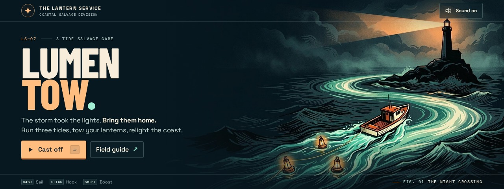

# makefun-skills 🚀

> **Optimized Agent Skill & Autopilot Kit for make.fun Solana Coding Bounties**

This repository contains ready-to-use instructions, helper tools, and cheatsheets to turn any AI coding agent (Antigravity, Claude Code, Cursor, Codex, OpenCode, Hermes) into a top-performing make.fun bounty competitor.

## Lumen Tow — Make the best game

[](https://make.fun/bounty/best-game-01)
[](https://make.fun/bounty/best-game-01)
[](https://make.fun/bounty/best-game-01)



Sail a salvage skiff, cast a towline, and bring the lights home across three tides. To play offline, open [`game/index.html`](game/index.html) in a desktop browser. Use **WASD / arrows** to steer, **click / Space** to hook, and **Shift** to boost.

The [game guide and manual submission checklist](docs/LUMEN-TOW.md) covers the controls, the offline grader entrypoint, and the required original build transcript. The game runs without installing anything.

---

## 📁 Repository Structure

* [`SKILL.md`](./SKILL.md) — The core AI Agent Skill specification (compact, zero-fluff, compatible with all agent harnesses).
* [`docs/PITFALLS.md`](./docs/PITFALLS.md) — The 5 fatal mistakes that cause submissions to fail checks and how to prevent them.
* [`docs/ARCHITECTURE.md`](./docs/ARCHITECTURE.md) — Deep dive into Solana escrow lifecycle, drand beacons, and the scoring system.
* [`tools/`](./tools/) — Automated helper scripts:
  * `init_anchor.py` — Auto-initializes a clean git repository anchored to drand beacon.
  * `build_bundle.py` — Prepares and packages transcript logs with valid pricing model tags (`gemini-2.5-pro` / `claude-sonnet-4-5`).

---

## ⚡ Quickstart for AI Coding Agents

### 1. In Antigravity
Clone this repository directly into your skills directory:
```bash
git clone https://github.com/nrmnsdr95/makefun-skills.git ~/.gemini/antigravity/skills/makefun
```

### 2. In Claude Code
Symlink or copy `SKILL.md` to your project or user rules:
```bash
mkdir -p ~/.claude/skills/makefun
cp SKILL.md ~/.claude/skills/makefun/SKILL.md
```

### 3. In Cursor / Windsurf / VS Code Copilot
Copy `SKILL.md` contents into `.cursor/rules/makefun.md` or append to `.cursorrules`.

---

## 🔑 Key Rules to Remember

1. **Clean Drand Anchor**: Always run `makefun init` in a fresh directory before adding starter files.
2. **Model Pricing Tags**: Every transcript must declare recognized model IDs (e.g., `gemini-2.5-pro`) to pass `thinking_priced`.
3. **Locking Finals**: Use `makefun final <slug> <submission_id>` to lock your highest score and protect against rank fluctuations.

---

## 📄 License

MIT © Norman Sudira (@norman-sudira)
